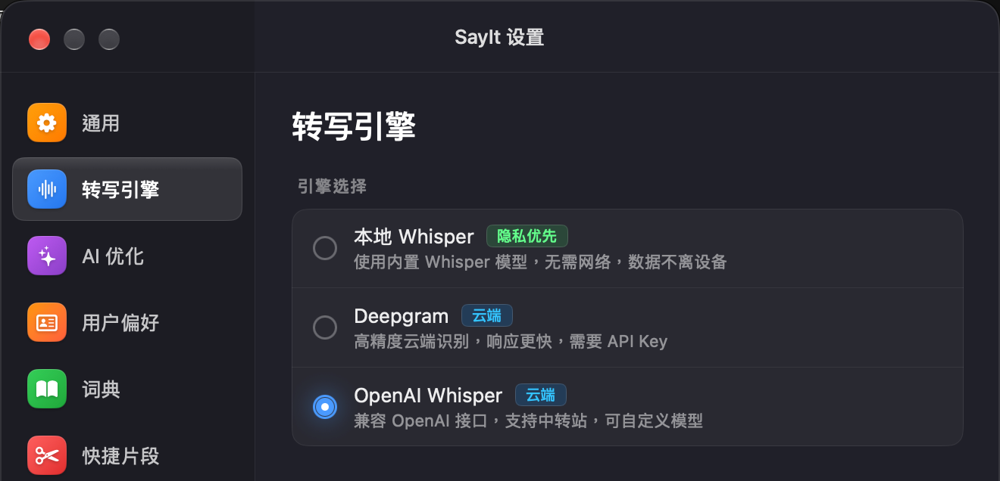
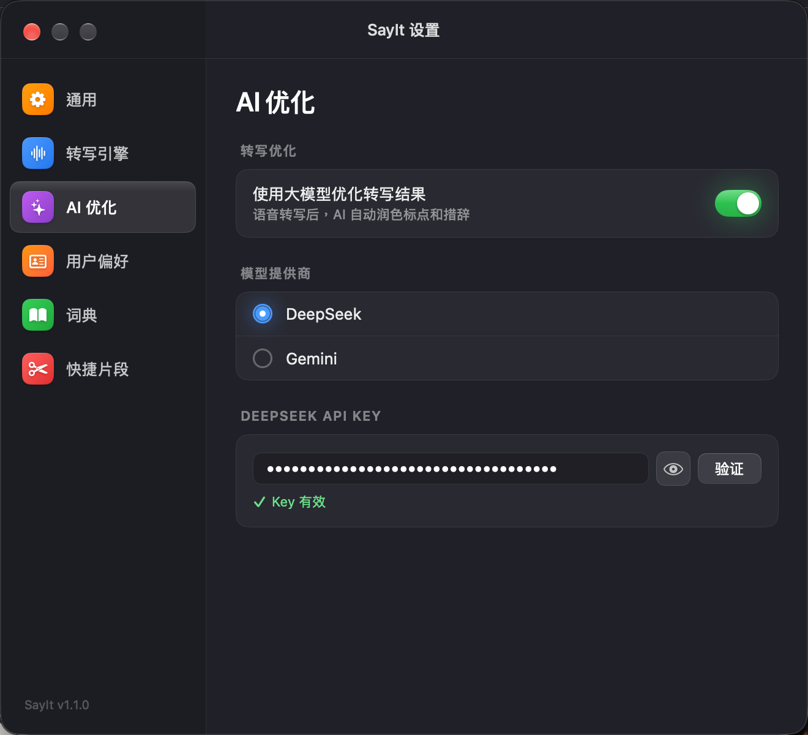
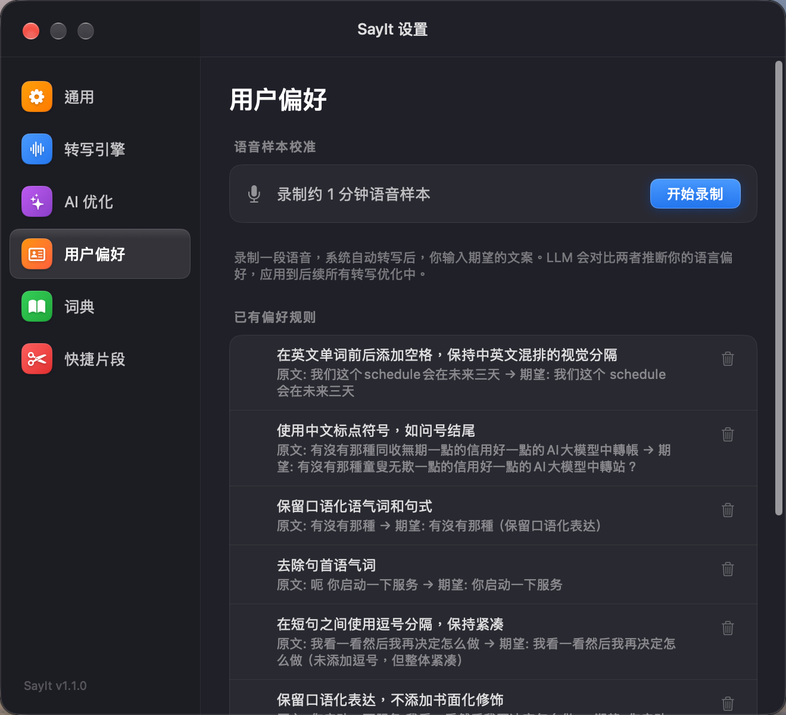

# SayIt


SayIt 是一款 macOS 菜单栏语音输入助手。它会把语音转成文字，并自动粘贴到你正在输入的地方。

当前版本：**v1.2.0**。需要 macOS 12 或更高版本，支持 Apple Silicon 与 Intel。

## 安装

从 [Releases](https://github.com/Jimmy-Chung/SayIt/releases/latest) 下载对应芯片的安装包：

- [SayIt-v1.2.0-AppleSilicon.dmg](https://github.com/Jimmy-Chung/SayIt/releases/download/v1.2.0/SayIt-v1.2.0-AppleSilicon.dmg)：Apple 芯片（M 系列）
- [SayIt-v1.2.0-Intel.dmg](https://github.com/Jimmy-Chung/SayIt/releases/download/v1.2.0/SayIt-v1.2.0-Intel.dmg)：Intel 芯片

打开 DMG，把 SayIt 拖到「应用程序」。第一次启动会打开设置窗口，并请求两项系统权限：

- **麦克风**：用于录音
- **辅助功能**：用于全局快捷键、自动粘贴，以及根据你事后改过的字来学习词典

应用常驻菜单栏，不占用 Dock。

## 怎么用

默认轻点 **Fn** 开始或结束录音（可在「通用」里改成 ⌘、⌥ 或 ⌃）。只有单独按下该键、并在 0.4 秒内松开、中间没有按过其他键时才会触发，所以 ⌘C 这类组合键不会误启动。录音中或 AI 润色时按 **Esc** 可以取消。

转写完成后，文字会写入剪贴板；若已授予辅助功能权限，会自动模拟 ⌘V 粘贴到刚才的输入位置。

### 1. 选择转写引擎

在设置的「转写引擎」里，可以选用三种方式：



- **本地 Whisper**（默认，隐私优先）：使用随应用打包的 Whisper 模型，不需要网络，音频不会离开这台电脑。
- **Deepgram**：云端流式识别，边说边出字，速度更快，需要 API Key。
- **OpenAI Whisper**：把整段录音上传到 OpenAI 兼容接口。可以自定义 API Base URL 和模型名，因此也能走中转站（默认模型为 `whisper-1`）。

如果当前选的是云端引擎但没有网络，会自动改走本地模型，并跳过后面的大模型润色。

### 2. 用大模型润色转写结果

语音转成文字之后，可以再交给大模型做一次润色：主要修正识别错误、标点和措辞，不会擅自扩写，也不会把你的话当成问题来回答。



在「AI 优化」中打开开关，选择 DeepSeek 或 Gemini，填入 API Key 并点「验证」。开启后，每次转写都会先得到原文，再按你的设置优化一遍后粘贴。

### 3. 用一段样本学习你的语言习惯

如果希望润色更贴近你平时的写法，可以到「用户偏好」里录大约 1 分钟语音。系统先转写出一版文字，你再贴上「期望文案」。大模型会对比两者，归纳标点、空格、语气等规则（例如中英文之间加空格、去掉句首语气词），并应用到之后的每一次优化里。

词汇对错由「词典」负责；这里只学习表达习惯。



## 其他功能

- **词典**：可手动添加「正确词 + 常见误识」。粘贴之后，如果你在输入框里改了一个词（例如把「铜搜无期」改成「童叟无欺」），应用也会自动把这对词收进词典。
- **快捷片段**：说出触发词即可展开常用文案，支持 `{{clipboard}}`、`{{date}}`、`{{time}}` 占位符。
- **语音命令**：把「句号」「换行」等说成对应符号。
- **转写历史**：在本地同时保存原文、润色后的文本，以及当次使用的引擎。

数据文件在 `~/Library/Application Support/SayIt/`。API Key 存在系统的 UserDefaults 里，不会写进这些文件。

## 从源码构建

需要 [Xcode](https://developer.apple.com/xcode/) 和 [XcodeGen](https://github.com/yonaskolb/XcodeGen)。本仓库通过 submodule 引用 [whisper.cpp](https://github.com/ggml-org/whisper.cpp)，克隆时请带上子模块：

```bash
git clone --recurse-submodules https://github.com/Jimmy-Chung/SayIt.git
cd SayIt
```

本地 Whisper 需要 `ggml-base.bin` 模型（约 141 MB，不在 Git 中）。下载并编译静态库：

```bash
bash vendor/whisper.cpp/models/download-ggml-model.sh base
# 在 vendor/whisper.cpp 中按官方方式编译，并将 libwhisper_all 放到
# vendor/whisper.cpp/build-macos/（工程会链接该目录）
xcodegen generate
xcodebuild -project SayIt.xcodeproj -scheme SayIt -configuration Debug build
```

## 技术概要

一次完整输入分为四步：**触发录音 → 转写 → 后处理 → 输出**。

1. **录音**：用 `CGEventTap` 监听修饰键；`AVAudioEngine` 采集 PCM。录音中会计算音量驱动悬浮窗，并可在系统正在播放声音时先暂停再恢复。超过 3 秒且几乎没有声音则直接退出。
2. **转写**：三种引擎共用 `TranscriptionService` 接口。本地路径内置 whisper.cpp（Metal 加速，录音中每 2 秒预览一次）；Deepgram 走 Nova-3 WebSocket 流式识别；OpenAI Whisper 在结束后上传整段音频（优先 M4A，失败则退回 WAV）。
3. **后处理**：依次做语音命令替换、快捷片段展开，以及可选的 LLM 润色。润色时会带上用户词典、偏好规则，以及当前前台应用的风格（邮件更正式、聊天更短、编辑器保留术语等）。
4. **输出**：写入剪贴板，并在已授权时模拟 ⌘V 粘贴。

## 开源协议

本项目采用 [MIT](LICENSE) 协议。
